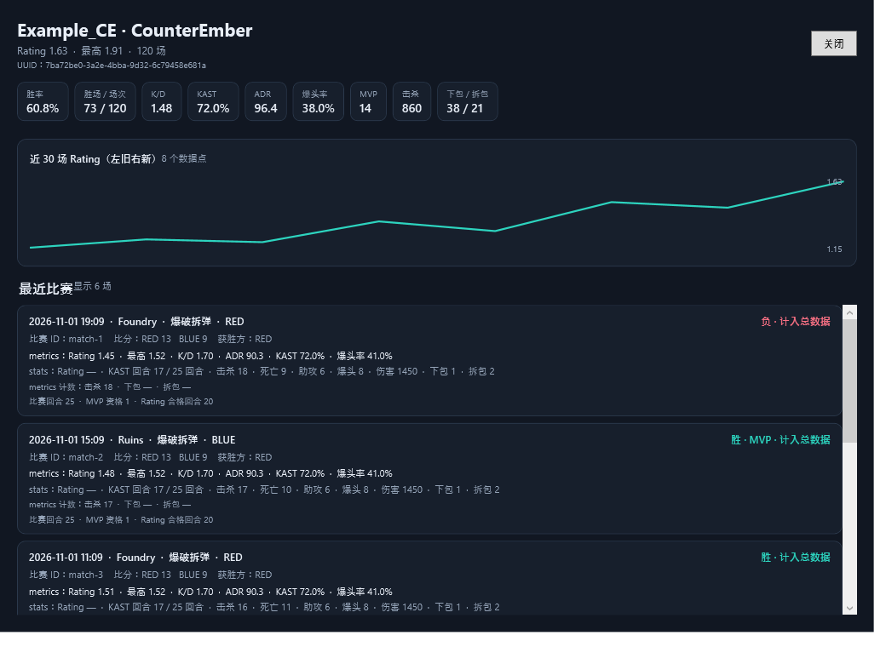

# IMC.RE Overlay

一个 Windows 战绩悬浮窗，支持 IMC.RE 的起床战争和 CounterEmber，并提供 KitBattle 榜单、Party 分析和玩家 VS 对比。使用 C# 和 WPF 编写。


*截图使用虚构玩家和示例数据。*

CounterEmber 查询还可打开 Rating 趋势和近期比赛明细：



*查询明细截图使用虚构玩家和示例数据。*

## 使用

1. 从 Releases 下载 Windows x64 发布包并解压，运行 `IMCBedwarsOverlay-CSharp.exe`。
2. 在「设置」选择查询模式：初次使用默认为起床战争，之后会记住所选模式。可在此绑定「我的游戏 ID」，以及手动测试 `api.imc.re` 网络连通性。
3. 进入 IMC.RE 大厅，打开聊天框、输入空格并按 Tab，悬浮窗会尝试从客户端日志读取玩家名单。
4. 点击「天梯榜单」可浏览 BedWars Rating Pro 或 CounterEmber 官方 Rating 的全服 Top 50，并按分类切换、排序；若绑定个人 ID，会在榜首置顶显示个人名次。排行榜窗口中的「KitBattle 榜」可按击杀、K/D 或经验查看 IMC.RE 官方分页数据，每页 50 名并显示服务器原始全服名次。
5. 使用「Party」输入 2–4 名玩家，获取团队均值和按模式分配的互补职责；使用「VS」比较两位玩家的对应模式数据。两项功能直接在表格窗口显示并支持复制结果，不生成图片卡片；VS 支持 BedWars、CounterEmber 和 KitBattle。
6. 点击玩家行复制战绩，或使用「查询玩家」查询指定玩家。

软件启动时会自动在后台自检 `api.imc.re` 网络连通性。若正常连接则保持静默；若被系统防火墙、网络代理或 DNS 异常阻拦，将在主窗口顶部显示醒目的排查提醒。

查询成功后可以选择「用图片查看」，生成带玩家头像、模式数据和日期的战绩卡，再将 PNG 保存到「图片\IMC.RE」文件夹并自动复制到剪贴板。背景使用 Minecraft 官方壁纸，首次生成需要联网加载。

默认按 `\` 显示或隐藏悬浮窗（支持在设置中交互式录制任意按键或组合键，如 `F8`、`Ctrl + Tab`，支持一键恢复默认）；右上角 × 退出程序。顶栏支持一键「清空」同局列表；查询玩家支持最近历史记录快速重查。悬浮窗自动记忆停靠位置与窗口尺寸，并可在设置中开启极其危险玩家进场音效预警。可在设置中调整不透明度，并拖动窗口右下角手柄缩放。

起床战争显示胜率、MVP、FKDR、拆床和终杀；CounterEmber 显示 Rating、K/D、ADR 和爆头率。点击表头可排序。数据来自 IMC.RE 的公开战绩接口，头像通过 mc-heads.net 加载。

当离线玩家与正版玩家同名时，请按服务器名单保留离线玩家名前缀 `-`，例如 `-yys_wys`。前缀不会被去掉：`-yys_wys` 和 `yys_wys` 会分别扫描、查询、缓存和显示。

KitBattle 使用独立的 `/kitbattle/leaderboard` 分页接口，只在其官方榜单页展示击杀、K/D、经验和全服名次；不会将 BedWars Rating Pro 或 CounterEmber Rating 套用到 KitBattle。Party 职责按模式选择：BedWars 根据 Rating Pro、FKDR、场均拆床、K/D 与胜率分配；CounterEmber 根据 ADR、K/D 与胜率分配。VS 使用同模式的有效指标计分，零场或缺失数据不产生优势项。

### 起床战争 Rating Pro

起床战争 **Rating Pro** 是本项目的启发式估算，**不是 IMC.RE 的官方评分**。终杀效率与场均拆床占 85% 权重，WLR 和普通 KDR 作为辅助指标；场次只用于样本置信度修正，不会额外加分。

令 `n` 为比赛总场次、`w` 为胜场数、`l = n - w` 为负场数、`b` 为场均拆床、`f` 为 FKDR、`k` 为 KDR。所有比率使用至少为 1 的分母；FKDR 和 KDR 使用 IMC.RE 汇总接口返回的比率：

$$
b=\frac{\text{拆床总数}}{n}, \qquad
\mathrm{FKDR}=\frac{\text{终杀}}{\max(1,\text{终死})}, \qquad
\mathrm{WLR}=\frac{w}{\max(1,l)}, \qquad
\mathrm{KDR}=\frac{\text{击杀}}{\max(1,\text{死亡})}.
$$

四项指标分别转换并限制范围：

$$
\begin{aligned}
F &= \min\left(\max\left(\log_2\frac{f+1}{2},-1\right),3\right), \\
B &= \min\left(\max\left(\log_2(b+0.5),-1\right),2\right), \\
W &= \min\left(\max\left(\log_2\frac{\mathrm{WLR}+1}{2},-1\right),2\right), \\
K &= \min\left(\max\left(\log_2\frac{\mathrm{KDR}+1}{2},-1\right),2\right), \\
P &= 0.45F + 0.40B + 0.10W + 0.05K, \\
C(n) &= \frac{n}{n+20}.
\end{aligned}
$$

$$
\mathrm{Rating\ Pro}=\min\left(\max\left(1+1.25\,C(n)P,0.10\right),3.00\right).
$$

最终分数限制在 0.10 到 3.00。0 场比赛或统计数据无效时不显示评分；少于 10 场时分数后显示 `*`。计算使用未舍入数值，显示时保留两位小数。

威胁等级按未舍入的 Rating 判断：2.00–3.00 为「极其危险」，1.40–未满 2.00 为「危险」，0.85–未满 1.40 为「普通」，0.10–未满 0.85 为「低威胁」。表格整行对「极其危险」标红、「危险」标黄、「低威胁」使用蓝色提示；「普通」保持常规背景。CounterEmber 仍使用 IMC.RE 官方 Rating，但复用相同的界面威胁分级。跨模式的分数不能直接比较。

Rating Pro 的权重和分级尚未依据全服数据校准，仅供快速参考，不能代表真实水平或判定玩家身份。

日志句柄枚举使用 Windows 的 `NtQueryInformationProcess` 内部接口。微软说明该接口可能随 Windows 版本变化，因此程序在接口不可用或权限不足时会退回到游戏目录推测。[API 文档](https://learn.microsoft.com/en-us/windows/win32/api/winternl/nf-winternl-ntqueryinformationprocess)。

## 构建

使用 Windows 和 .NET 10 SDK：

```powershell
dotnet publish .\IMCBedwarsOverlay.csproj -c Release -r win-x64 --self-contained true -p:PublishSingleFile=true -p:IncludeNativeLibrariesForSelfExtract=true -o .\publish
```

配置存放在 `%APPDATA%\IMCBedwarsOverlay\config.json`。程序会筛选运行中的 Minecraft `java.exe`/`javaw.exe` 客户端，优先从其正在写入的文件句柄定位 `latest.log`，支持 Badlion Client / BLC、Lunar、Feather 和自定义游戏目录。BLC 同时打开聊天日志和游戏日志时，会优先选择 `minecraft` 主日志；多个客户端同时运行时优先选择前台游戏。若 Windows 不允许读取进程句柄，只会按该 Java 进程自己的 `--gameDir` 推测日志位置；没有可确认的游戏目录时，不会回退到其他启动器或旧日志。

CounterEmber 查询会显示接口提供的胜率、胜场、MVP、Rating、最高 Rating、K/D、KAST、ADR、爆头率、击杀、下包和拆包数据。查询窗口还提供近 30 场 Rating 趋势与最近 15 场比赛明细，包括地图、模式、队伍、比分、结果及逐场数据。

回归检查：

```powershell
dotnet run --project .\tests\Overlay.Checks\Overlay.Checks.csproj -c Release
```

## 许可证与发布文件校验

本项目代码使用 [GPL-3.0-only](LICENSE)，第三方代码许可见 [THIRD_PARTY_NOTICES.md](THIRD_PARTY_NOTICES.md)。Minecraft 壁纸、玩家头像和相关商标属于各自权利人，不因本项目许可证获得授权；请遵守 [Minecraft 壁纸页面的使用条款](https://www.minecraft.net/en-us/collectibles)。

新版 Release 同时提供 ZIP 和对应的 `.sha256` 文件。可在 PowerShell 中运行 `Get-FileHash .\IMC-Overlay-版本号-win-x64.zip -Algorithm SHA256`，并与 `.sha256` 文件中的值比较。校验和用于检查文件是否一致，不单独证明发布者身份。

## 发布新版本

将版本标签推送到 GitHub 后，Actions 会自动构建独立的 Windows x64 程序、打包并创建 Release。例如：

```powershell
git tag v2.2-radar
git push origin v2.2-radar
```

测试与探测标签（例如 `v1.3-probe`）会发布为预发行版本，正式版本标签（例如 `v2.2-radar`、`v2.0.0`）会发布为正式发行版（Release）。普通分支推送不会自动创建 Release。

也可在 GitHub Actions 中手动运行工作流验证构建；手动运行只上传供下载的 Actions 构建产物，不创建 Release。
