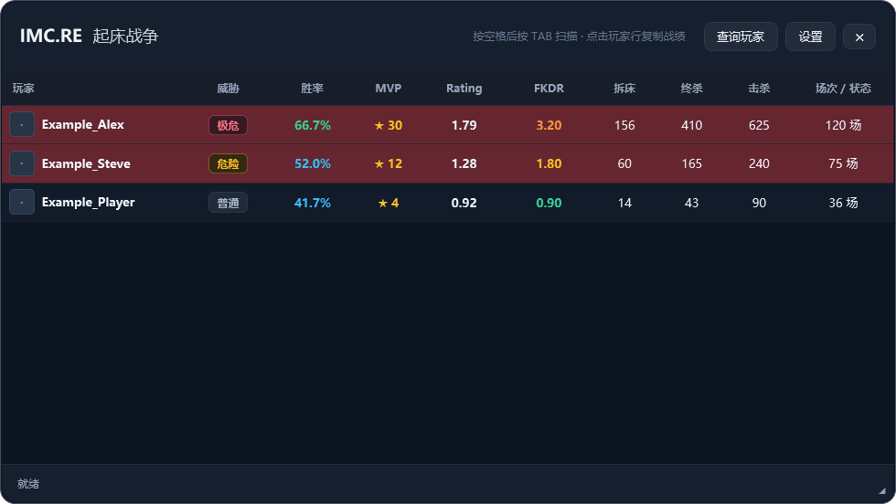

# IMC.RE Overlay

一个 Windows 战绩悬浮窗，支持 IMC.RE 的起床战争和 CounterEmber。使用 C# 和 WPF 编写。



*截图使用虚构玩家和示例数据。*

## 使用

1. 从 Releases 下载 Windows x64 发布包并解压，运行 `IMCBedwarsOverlay-CSharp.exe`。
2. 在「设置」选择查询模式：初次使用默认为起床战争，之后会记住所选模式。
3. 进入 IMC.RE 大厅，打开聊天框、输入空格并按 Tab，悬浮窗会尝试从客户端日志读取玩家名单。
4. 点击玩家行复制战绩，或使用「查询玩家」查询指定玩家。

查询成功后可以选择「用图片查看」，生成带玩家头像、模式数据和日期的战绩卡，再将 PNG 保存到「图片\IMC.RE」文件夹并自动复制到剪贴板。背景使用 Minecraft 官方壁纸，首次生成需要联网加载。

按 `\` 显示或隐藏悬浮窗；右上角 × 退出程序。可在设置中调整不透明度，并拖动窗口右下角的手柄按比例调整大小。

起床战争显示胜率、MVP、FKDR、拆床和终杀；CounterEmber 显示 Rating、K/D、ADR 和爆头率。点击表头可排序。数据来自 IMC.RE 的公开战绩接口，头像通过 mc-heads.net 加载。

### 起床战争估算 Rating

起床战争 Rating 是本项目的启发式估算，**不是 IMC.RE 或 CS2 的官方评分**，也不能与 CounterEmber 的官方 Rating 直接比较。它以 1.00 为中性基准，结合 FKDR、胜率和场均拆床，再根据场次降低低样本的影响。计算方式大致如下：

令 $n$ 为对局数、$w$ 为胜率（如 60% 记为 $0.6$）、$f$ 为 FKDR、$b$ 为场均拆床数。用 $\operatorname{clip}(x,a,b)$ 表示将 $x$ 限制在 $[a,b]$ 范围内：

$$
\begin{aligned}
W &= \operatorname{clip}\!\left(2(w-0.5),\,-1,\,1\right), \\
F &= \operatorname{clip}\!\left(\log_2\!\left(\frac{\max(0,f)+1}{2}\right),\,-1,\,2\right), \\
B &= \operatorname{clip}\!\left(\frac{b-0.5}{0.5},\,-1,\,2\right).
\end{aligned}
$$

$$
\operatorname{Rating} = \operatorname{clip}\!\left(
1 + \frac{n}{n+20}\left(0.45F + 0.35W + 0.20B\right),\;0.25,\;2.50
\right).
$$

少于 10 场时数字后显示 `*`，提示样本不足；无对局时不显示评分。威胁标签使用估算值分级：1.35 及以上为「极危」、1.12 至 1.35 以下为「危险」，其他为「普通」。累计拆床数不直接提高评分。

当显示到小数点后两位的有效 Rating 严格大于 1.00 时，玩家整行会显示红色背景；该规则也适用于 CounterEmber 的官方 Rating。红色仅表示显示数值高于 1.00，不能单独作为实力或威胁判定。

评分仅用于快速参考，权重和分级尚未依据服务器玩家数据校准，不能代表真实水平或判定玩家身份。

## 构建

使用 Windows 和 .NET 10 SDK：

```powershell
dotnet publish .\IMCBedwarsOverlay.csproj -c Release -r win-x64 --self-contained true -p:PublishSingleFile=true -p:IncludeNativeLibrariesForSelfExtract=true -o .\publish
```

配置存放在 `%APPDATA%\IMCBedwarsOverlay\config.json`。游戏客户端的日志位置和实际扫描行为取决于客户端版本；如自动扫描未识别，可使用「查询玩家」。

回归检查：

```powershell
dotnet run --project .\tests\Overlay.Checks\Overlay.Checks.csproj -c Release
```

## 许可证与发布文件校验

本项目代码使用 [GPL-3.0-only](LICENSE)，第三方代码许可见 [THIRD_PARTY_NOTICES.md](THIRD_PARTY_NOTICES.md)。Minecraft 壁纸、玩家头像和相关商标属于各自权利人，不因本项目许可证获得授权；请遵守 [Minecraft 壁纸页面的使用条款](https://www.minecraft.net/en-us/collectibles)。

新版 Release 同时提供 ZIP 和对应的 `.sha256` 文件。可在 PowerShell 中运行 `Get-FileHash .\IMC-Overlay-版本号-win-x64.zip -Algorithm SHA256`，并与 `.sha256` 文件中的值比较。校验和用于检查文件是否一致，不单独证明发布者身份。

## 发布新版本

将版本标签推送到 GitHub 后，Actions 会自动构建独立的 Windows x64 程序、打包并创建 Release。例如：

```powershell
git tag v1.0.1
git push origin v1.0.1
```

包含连字符的版本标签（例如 `v1.1-probe`）会发布为预发行版本。普通分支推送不会自动创建 Release。

也可在 GitHub Actions 中手动运行工作流验证构建；手动运行只上传供下载的 Actions 构建产物，不创建 Release。
